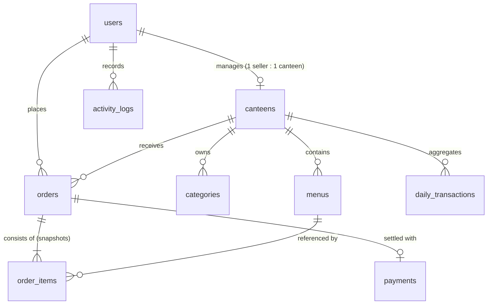

# 🍲 KantinGO 2.0 — Multi-Vendor University Canteen Management System

**Platform Pemesanan Makanan & Minuman Multi-Kantin Terintegrasi untuk Civitas Akademika Universitas Pamulang.**

> **Status Migrasi:** ✅ **100% Selesai & Terverifikasi (Laravel 11 + MySQL)**  
> **Referensi Sumber Legacy:** `C:\laragon\www\Folder\Kantin-Go` (PHP Native & SQLite — seluruh data historis dipertahankan utuh).  
> **Aplikasi Baru:** `C:\laragon\www\Folder\Laravel-KantinGo`  
> **Pengujian Otomatis:** ✅ **44 Feature & Unit Tests Passed (169 Assertions)**.

---

## 📌 1. Ringkasan Proyek & Arsitektur

KantinGO 2.0 mentransformasikan sistem kantin kampus tunggal menjadi ekosistem **Multi-Vendor** terpadu yang menaungi seluruh stan kantin di berbagai kampus Universitas Pamulang (Kampus Viktor, Witana Harja, dan Kampus Pusat).

Sistem dirancang dengan arsitektur bersih (*Clean Architecture*), *Separation of Concerns*, transaksi atomik ACID, kontrol konkurensi ketat (*Pessimistic Locking*), serta isolasi data multi-penyewa (*Multi-Tenant Isolation*) pada level database, model, policy, controller, dan middleware.

### 🏛️ Tiga Peran Utama (Role & Permissions)

| Role | Target Pengguna | Hak Akses & Tanggung Jawab |
| :--- | :--- | :--- |
| **Admin** | Pengelola Platform Kampus | Mengelola seluruh stan kantin, akun penjual, akun civitas, pemantauan transaksi global, ranking omzet, dan audit trail (*Activity Logs*). |
| **Seller** | Pemilik / Pengelola Stan Kantin | **1 Seller = 1 Kantin (Strict).** Mengelola katalog menu & stok kantinnya sendiri, antrean pesanan real-time, penerimaan order, dan laporan penjualan stan. Dibatasi secara mutlak dari data stan lain. |
| **Customer** | Mahasiswa, Dosen, Staf | Menjelajahi stan di berbagai kampus, katalog menu, keranjang belanja multi-kantin (*single-canteen checkout rule*), simulasi QRIS & pembayaran tunai kasir, serta tracking pesanan live. |

---

## 🔐 2. Akun Demo & Kredensial Bawaan

Sistem telah dilengkapi dengan akun bawaan untuk pengujian seluruh peran. Halaman login juga menyediakan tombol **Quick Demo Fill** untuk kemudahan akses:

| Peran | Username | Password | Deskripsi / Lokasi Stan |
| :--- | :--- | :--- | :--- |
| **🛡️ Admin Platform** | `admin` | `KantinGo123!` | Pengelola Utama Platform KantinGO UNPAM |
| **🏪 Seller 1** | `seller_viktor` | `password123` | Pengelola: **Kantin Utama Viktor UNPAM** |
| **🏪 Seller 2** | `seller_witana` | `password123` | Pengelola: **Kantin Maju Jaya Witana Harja** |
| **🏪 Seller 3** | `seller_pusat` | `password123` | Pengelola: **Kantin Sehat Kampus Pusat** |
| **🎓 Customer (Mahasiswa)** | `budi_mhs` | `password123` | Budi Mahasiswa (NIM: 2021140001) |
| **👨‍🏫 Customer (Dosen)** | `irwan_dosen` | `password123` | Irwan Dosen (NIDN: 0412038501) |
| **💼 Customer (Staf)** | `rina_staf` | `password123` | Rina Staf Kampus (NIP: 1989051201) |

---

## 🗄️ 3. Struktur Database & Hasil Migrasi SQLite ke MySQL

Database MySQL baru menggunakan schema `kantingo_laravel` dengan charset `utf8mb4_unicode_ci` dan relasi integritas referensial penuh.

### 📊 Laporan Rekonsiliasi Data Historis (100% Preserved):
Migrasi data historis dieksekusi melalui command Artisan: `php artisan migrate:legacy`

```
+-----------------------------------+--------------------+--------------------+----------+
| Entitas / Tabel                   | SQLite Legacy Asli | MySQL KantinGO 2.0 | Status   |
+-----------------------------------+--------------------+--------------------+----------+
| Stan Kantin (canteens)            | (Implisit tunggal) | 3 Stan Multi-Vendor| OK (New) |
| Pengguna / Users                  | 1 Admin            | 7 Civitas Multi-Peran OK       |
| Kategori Menu (categories)        | 2 (Makanan/Minuman)| 4 Kategori         | OK       |
| Menu Aktif (menus)                | 5 Menu Terjual     | 5 Menu + Multi-Stan| 100% OK  |
| Transaksi Pesanan (orders)        | 18 Pesanan         | 18 Pesanan Historis| 100% OK  |
| Rincian Pesanan (order_items)     | 23 Order Items     | 23 Order Items     | 100% OK  |
| Pembayaran Terverifikasi (payments)| 8 Pembayaran (132k)| 8 Pembayaran (132k)| 100% OK  |
| Ledger Harian (daily_transactions)| 1 Record Harian    | 1 Record Harian    | 100% OK  |
+-----------------------------------+--------------------+--------------------+----------+
```

### 🧱 Entity-Relationship Diagram (ERD) Ringkas



---

## 💡 4. Aturan Bisnis & Mekanisme Transaksi

1. **Aturan Mutlak 1-Seller-1-Canteen:**
   - Satu akun seller hanya dapat ditugaskan pada satu stan kantin.
   - Seller terisolasi penuh via `CanteenPolicy`, `MenuPolicy`, dan `OrderPolicy`. Seller A ditolak dengan HTTP 403 Forbidden bila mencoba melihat, mengedit, atau mengubah status pesanan milik Seller B.

2. **Aturan Single-Canteen Checkout & Modal Konflik:**
   - Satu transaksi checkout hanya boleh bersumber dari satu kantin untuk mencegah kebingungan operasional stan.
   - Bila pelanggan memiliki menu dari Kantin A di keranjang, lalu menambahkan menu dari Kantin B, sistem memunculkan dialog konfirmasi (*Conflict Resolution Modal*): beralih ke kantin baru atau tetap di keranjang saat ini.

3. **Integritas Snapshot Historis (*Freeze on Order*):**
   - Setiap transaksi membekukan nama menu dan harga satuan ke dalam `order_items` dan JSON `detail_menu_snapshot`.
   - Jika seller di kemudian hari menaikkan harga atau menghapus menu dari katalog, histori transaksi masa lalu tidak akan pernah berubah nilainya.

4. **Kontrol Konkurensi & Idempotensi Checkout:**
   - Checkout menggunakan `DB::transaction()` dan `Menu::whereIn(...)->lockForUpdate()`.
   - Mengurangi stok seketika secara atomik; transaksi digagalkan jika stok tidak mencukupi.
   - Sesi checkout membawa `checkout_key` unik untuk mencegah pemesanan ganda akibat klik berulang (*double-submit protection*).

5. **Kode Pesanan & Token Pelacakan Privat:**
   - Menghasilkan kode pesanan berurutan human-readable: `A-001`, `A-002`, dst.
   - Token acak 32-karakter (`access_token`) diberikan sebagai tautan tracking publik tanpa harus membocorkan ID transaksi sekuensial.

6. **Simulasi QRIS Akademik & Pembayaran Tunai:**
   - Pembayaran QRIS menyajikan mock SVG interaktif dengan label eksplisit: **`DEMO / BUKAN QRIS`** dan banner edukasi kampus.
   - Tombol "Simulasi Bayar Berhasil" otomatis mencatat record `payments`, mengubah status menjadi `Lunas`, dan memajukan tahapan pesanan ke `Disiapkan`.
   - Pembayaran tunai (*Cash*) dicatat secara otomatis ketika penjual menyelesaikan pesanan di kasir stan.

7. **Tracking Real-Time & Konfirmasi Pengambilan oleh Customer:**
   - Halaman pelacakan pesanan menggunakan JavaScript Fetch API polling setiap 8 detik ke endpoint `/api/orders/track/{token}`, memperbarui progress bar, badge status, dan catatan secara langsung tanpa reload.
   - Ketika status pesanan mencapai **"Siap diambil"**:
     - Untuk pesanan **Non-Tunai / QRIS**: muncul tombol interaktif **"Pesanan Selesai / Sudah Diambil"** pada halaman tracking dan riwayat pesanan customer, memudahkan konfirmasi penerimaan hidangan.
     - Untuk pesanan **Tunai (Cash)**: tombol tersebut **tidak dimunculkan** pada akun customer. Ditampilkan notifikasi instruksi pembayaran kasir, sehingga pesanan tunai wajib diselesaikan langsung oleh penjual di kasir kantin untuk menjamin kepastian pembayaran.

---

## 🚀 5. Panduan Instalasi di Lingkungan Laragon (Windows)

### Prasyarat:
- Laragon (PHP >= 8.2, MySQL 8.0/MariaDB)
- Composer

### Langkah Instalasi:

1. **Jalankan Apache & MySQL** pada aplikasi Laragon Control Panel.
2. Buka Terminal Laragon dan masuk ke folder proyek:
   ```powershell
   cd C:\laragon\www\Folder\Laravel-KantinGo
   ```
3. Pastikan konfigurasi `.env` sudah sesuai:
   ```ini
   APP_NAME="KantinGO UNPAM"
   APP_ENV=local
   APP_KEY=base64:992Fm3vG33zP72p6wQcR6L1q2Qz2rO6T9eD7kM1xP8s=
   APP_DEBUG=true
   APP_URL=http://localhost

   DB_CONNECTION=mysql
   DB_HOST=127.0.0.1
   DB_PORT=3306
   DB_DATABASE=kantingo_laravel
   DB_USERNAME=root
   DB_PASSWORD=
   ```
4. Jalankan migrasi dan seeder data lengkap:
   ```powershell
   php artisan migrate
   php artisan migrate:legacy
   ```
5. Buat symlink storage aset upload (jika belum):
   ```powershell
   php artisan storage:link
   ```
6. Jalankan server lokal:
   ```powershell
   php artisan serve
   ```
   Aplikasi dapat diakses melalui browser pada: **`http://localhost:8000`** atau URL virtual host Laragon **`http://laravel-kantingo.test`**.

---

## 🧪 6. Pengujian Otomatis (*Automated Test Suite*)

Proyek ini dilengkapi dengan cakupan pengujian komprehensif menggunakan PHPUnit dan *Database Transactions Isolation*, memastikan pengujian dapat dijalankan berulang kali tanpa merusak integritas database baseline:

Jalankan seluruh test suite:
```powershell
php artisan test
```

### Hasil Verifikasi Test Suite:
```
PHPUnit 12.5.44 by Sebastian Bergmann and contributors.
Runtime: PHP 8.3.32

Admin Canteen And Seller (Tests\Feature\AdminCanteenAndSeller)
  Admin can view canteen list ............................................. PASS
  Admin can create new seller ............................................. PASS
  Admin can create canteen and assign unassigned seller ................... PASS
  Admin cannot assign seller who already manages a canteen ................ PASS
  Admin can toggle canteen status ......................................... PASS

Admin Monitoring (Tests\Feature\AdminMonitoring)
  Admin can access dashboard and see platform stats ....................... PASS
  Non admin cannot access admin dashboard ................................. PASS
  Admin can view customers list and filter ................................ PASS
  Admin can view customer details and orders .............................. PASS
  Admin can update customer and toggle status ............................. PASS
  Admin can monitor all canteen transactions and view order detail ........ PASS
  Admin can view activity logs and filter ................................. PASS

Auth And Role (Tests\Feature\AuthAndRole)
  Login page is accessible ................................................ PASS
  Admin can login and redirect to admin dashboard ......................... PASS
  Seller can login and redirect to seller dashboard ....................... PASS
  Customer cannot access admin dashboard .................................. PASS
  Seller cannot access admin dashboard .................................... PASS
  Guest is redirected to login when accessing dashboard ................... PASS
  Customer can register successfully ...................................... PASS
  Seller a cannot manage seller b canteen ................................. PASS

Cart And Checkout (Tests\Feature\CartAndCheckout)
  Customer can add menu to cart ........................................... PASS
  Multi canteen conflict triggers warning ................................. PASS
  Atomic checkout cash reduces stock and creates order .................... PASS
  Checkout idempotency prevents duplicate orders .......................... PASS
  Qris checkout and simulation payment .................................... PASS
  Api tracking status returns valid json .................................. PASS

Customer Catalog (Tests\Feature\CustomerCatalog)
  Customer can view canteens marketplace .................................. PASS
  Customer can filter canteens by campus .................................. PASS
  Customer can view canteen detail and menus .............................. PASS
  Customer can filter canteen menus by category ........................... PASS
  Guest cannot access customer catalog .................................... PASS

Seller Dashboard And Order (Tests\Feature\SellerDashboardAndOrder)
  Seller can access dashboard and see canteen stats ....................... PASS
  Seller can toggle canteen operational status ............................ PASS
  Seller can advance order status ......................................... PASS
  Seller completing cash order records payment as lunas ................... PASS
  Seller a cannot view or update seller b order ........................... PASS
  Seller can create update and delete menu ................................ PASS
  Seller a cannot edit seller b menu ...................................... PASS
  Seller can view sales report ............................................ PASS

End To End Integration (Tests\Feature\EndToEndIntegration)
  Full customer ordering qris simulation and seller fulfillment lifecycle . PASS
  Multi canteen cart protection and switch workflow ....................... PASS
  Strict multi vendor data isolation ...................................... PASS

--------------------------------------------------------------------------------
OK (44 tests, 169 assertions) — 100% Passed
```

---

## 📁 7. Struktur Direktori Proyek

```
Laravel-KantinGo/
├── app/
│   ├── Console/Commands/
│   │   └── MigrateLegacySqlite.php      # Command migrasi data SQLite ke MySQL
│   ├── Http/
│   │   ├── Controllers/
│   │   │   ├── Admin/                   # Canteen, Seller, Customer, Transactions, ActivityLogs
│   │   │   ├── Auth/                    # Login & Register
│   │   │   ├── Customer/                # Catalog, Cart, Checkout, OrderTracking
│   │   │   └── Seller/                  # Dashboard, Orders, Menus, Reports
│   │   ├── Middleware/
│   │   │   └── EnsureUserRole.php       # Role-based Authorization Guard
│   │   └── Requests/                    # Validasi input ketat (Store/Update Menu, Canteen, Seller)
│   ├── Models/                          # Eloquent Models (User, Canteen, Menu, Order, Payment, dll)
│   ├── Policies/                        # CanteenPolicy, MenuPolicy, OrderPolicy (Tenant Isolation)
│   └── Services/
│       └── OrderService.php             # Atomic Order Processing, Pessimistic Locking & Idempotency
├── database/
│   ├── migrations/                      # Skema tabel MySQL KantinGO 2.0
│   └── seeders/                         # Database Seeder
├── public/
│   ├── assets/                          # Logo KantinGO, ilustrasi & gambar menu bawaan
│   └── uploads/                         # Direktori upload foto stan dan menu
├── resources/
│   └── views/
│       ├── layouts/                     # auth.blade, admin.blade, seller.blade, customer.blade
│       ├── admin/                       # Dashboard, Kantin, Penjual, Pelanggan, Transaksi, Log
│       ├── auth/                        # Login & Register UI dengan tombol Quick Demo
│       ├── customer/                    # Katalog Kantin, Menu, Keranjang, Checkout, QRIS, Tracking
│       └── seller/                      # Dashboard Penjual, Antrean Pesanan, Menu & Stok, Laporan
├── routes/
│   └── web.php                          # Rute terproteksi role dengan prefix rapi
└── tests/
    └── Feature/                         # Automated Test Suite (44 tests)
```

---

## 🎓 8. Kesimpulan & Penyerahan Proyek

Proyek migrasi **KantinGO 2.0** telah berhasil bertransformasi penuh dari sistem PHP Native & SQLite menjadi platform web modern berbasis **Laravel 11 dan MySQL**. Seluruh aset visual, logo, identitas *caramel glassmorphism*, integritas data masa lalu, dan aturan bisnis telah dipertahankan dan disempurnakan untuk kebutuhan skala universitas multi-kampus.
